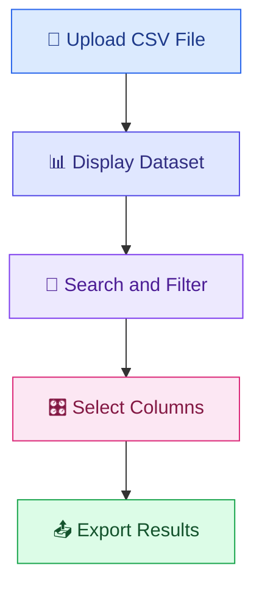
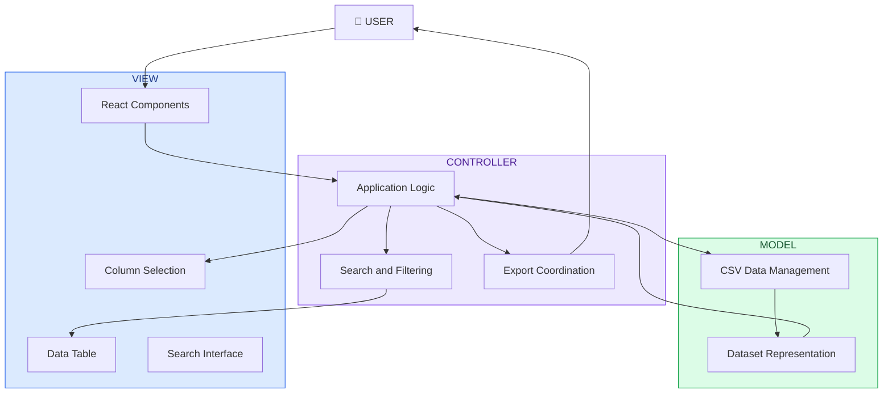

# CSV Explorer
### Explore your data. Find what matters.

<p align="center">
  <strong>A simple and intuitive way to explore, filter and export CSV datasets.</strong>
</p>

<p align="center">
  
  
  
  
</p>

---

## 📌 Overview

**CSV Explorer** is a web application developed with React that makes working with CSV files easier and more efficient.

It provides an intuitive interface to upload datasets, explore tabular information, perform targeted searches, customize displayed columns and export filtered results.

Whether you need to find a specific value, inspect selected fields or extract a subset of your data, CSV Explorer brings everything together in one simple workspace.

<p align="center">
  
</p>

---

## ✨ Key Features

<table>
<tr>
<td width="50%" valign="top">

### 📂 CSV Upload

Import CSV files directly into the application and start exploring their contents.

</td>
<td width="50%" valign="top">

### 📊 Interactive Data Table

Display CSV contents in a structured table for easier data consultation.

</td>
</tr>
<tr>
<td width="50%" valign="top">

### 🔎 Advanced Search

Search for values across entire rows or within specific columns.

</td>
<td width="50%" valign="top">

### 🎛️ Column Management

Choose which columns to display and customize your working view.

</td>
</tr>
<tr>
<td width="50%" valign="top">

### 🔍 Combined Filtering

Combine row-based and column-based searches to narrow down results.

</td>
<td width="50%" valign="top">

### 📤 CSV Export

Download the resulting dataset, including selected columns and filtered rows.

</td>
</tr>
</table>

---

## 🚀 How It Works

A straightforward workflow designed to make CSV exploration effortless.



### 01 — Upload your dataset

Select a CSV file and load its contents into the application.

### 02 — Explore the information

Browse the dataset through a structured tabular interface.

### 03 — Find what you need

Use two different search modes:

- **Row Search:** find rows containing a specific value.
- **Column Search:** search for a value within a selected column.

Search criteria can be combined to obtain more specific results.

### 04 — Customize your workspace

Select the columns you want to display and hide unnecessary information.

### 05 — Export your results

Generate a new CSV file containing the selected columns and the resulting rows after applying your search criteria.

---

## 🏗️ Architecture

CSV Explorer follows the **Model-View-Controller (MVC)** architectural pattern.

The application separates data management, application logic and user interface responsibilities.



### Architectural Responsibilities

| Component | Responsibility |
|---|---|
| **Model** | Manages CSV data and its representation. |
| **View** | Displays the application interface and dataset. |
| **Controller** | Coordinates application operations, searches, filtering and interactions. |

This separation promotes modularity, maintainability and a clearer organization of the application.

---

## 🛠️ Technology Stack

The project combines frontend development tools and libraries.

| Technology | Purpose |
|---|---|
| React | User interface development |
| JavaScript | Application logic |
| Bootstrap 4.6 | Responsive interface styling |
| React Bootstrap Table 2 | Tabular data presentation |
| CSS | Interface customization |

---

## ⚙️ Getting Started

Follow these steps to run the application locally.

### Prerequisites

Make sure you have installed:

- [Node.js](https://nodejs.org/)
- npm (included with Node.js)
- Git

### Installation

**1. Clone the repository**

```bash
git clone https://github.com/AllegraSalvatore/React_Progetto_IdS.git
```

**2. Navigate to the project directory**

```bash
cd React_Progetto_IdS
```

**3. Install dependencies**

```bash
npm install
```

**4. Start the development server**

```bash
npm start
```

Open the local address displayed in your terminal to access the application.

---

## 📁 Project Structure

```text
React_Progetto_IdS/
│
├── public/
│
├── src/
│
├── OBIB(1).csv
│
├── package.json
├── package-lock.json
└── README.md
```

---

## 🎯 Project Vision

CSV Explorer is designed to make CSV data exploration simple, intuitive and efficient.

By combining data visualization, flexible search capabilities and customizable column management, the application provides a straightforward workspace for working with tabular datasets.

Its main goals are:

- Simplify CSV file exploration.
- Make information easier to find through flexible search tools.
- Provide control over displayed data and columns.
- Enable the export of customized datasets.
- Deliver an intuitive and accessible user experience.

---

## 👩‍💻 Author

**Allegra Salvatore**

---

<p align="center">
  <strong>CSV Explorer</strong>
  <br />
  <a href="https://github.com/AllegraSalvatore/React_Progetto_IdS">View Repository</a>
</p>
